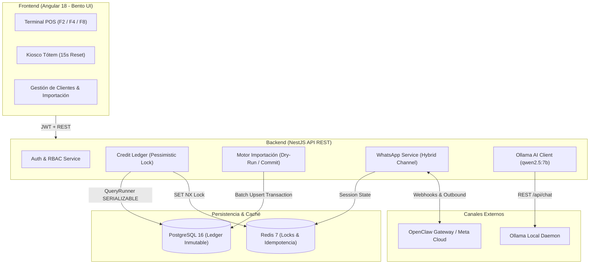
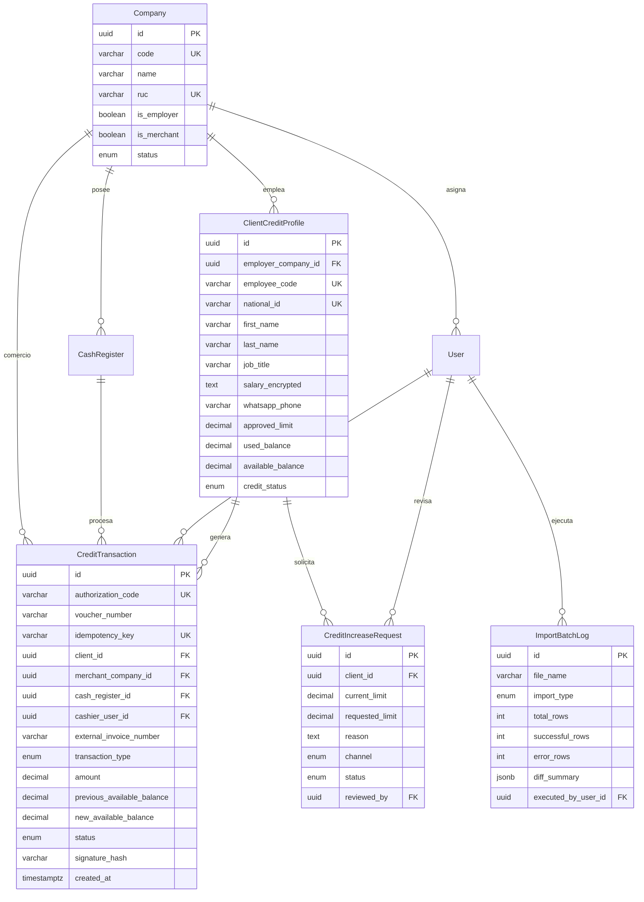

# 💳 CORP-CREDIT POS
### Plataforma Multi-Empresa de Gestión de Créditos Corporativos & Terminal POS Virtual

[](https://nestjs.com/)
[](https://angular.dev/)
[](https://www.postgresql.org/)
[](https://redis.io/)
[](https://ollama.com/)
[](LICENSE)

---

## 📖 1. Acerca del Sistema (About)

**CORP-CREDIT POS** es una plataforma web transaccional empresarial de alto rendimiento diseñada para la administración y cobro en punto de venta de líneas de crédito corporativo para empleados y colaboradores de grupos empresariales y cadenas comerciales afiliadas.

El sistema resuelve la problemática de autorización, cobro inmediato y deducción salarial sin intermediación bancaria tradicional, otorgando a las empresas la capacidad de operar como su propio emisor de tarjetas virtuales y terminal de crédito cerrado con:
1. **Integridad Financiera Inmutable (Ledger Pattern):** Bloqueo transaccional pesimista (`pessimistic_write`) con nivel de aislamiento ACID en PostgreSQL, garantizando cero sobregiros en cobros concurrentes y sellado criptográfico SHA-256 por cada movimiento contable.
2. **Ergonomía de Caja a Velocidad de Teclado/Lector:** Diseñado para cajeros de supermercados, farmacias y tiendas con atajos globales (`F2` enfocar lector, `F4` procesar cobro, `F8` reimprimir) e interfaz Bento Grid Modular con paleta ejecutiva (`#0F172A`, `#10B981`, `#F59E0B`, `#991B1B`).
3. **Impresión Térmica Nativa (80mm & 58mm):** Voucher bancario idéntico a terminales BAC/Lafise con dos copias (`ORIGINAL: COMERCIO` y `COPIA: CLIENTE`), pagaré legal, desglose financiero y código QR dinámico de autenticidad.
4. **Canal de Autoservicio WhatsApp a Costo Cero:** Flujo híbrido Inbound (Meta Cloud API / OpenClaw) iniciado por el cliente mediante código QR con ventana gratuita de 24h, integrado a un clasificador semántico local con **Ollama (`qwen2.5:7b`)** y fallback determinístico por menú numérico.
5. **Kiosco Tótem de Autogestión:** Vista pública con reinicio automático de 15 segundos para consulta express de disponibilidad en tablets corporativas.

---

## 🚀 2. Características Principales

### 🛒 Terminal POS Virtual (Cajeros)
* **Escaneo Instantáneo:** Búsqueda en milisegundos mediante código de barras, carnet QR o número de cédula.
* **Tarjeta Bento de Disponibilidad:** Muestra saldo disponible en formato gigante, porcentaje de consumo con semáforo inteligente (Verde Esmeralda `<75%`, Ámbar `>75%`, Rojo `Bloqueado/Congelado`).
* **Mini-Ticket de Disponibilidad:** Impresión térmica rápida si el cliente solo requiere consultar su techo disponible antes de seleccionar productos.
* **Cobro Seguro con Idempotencia:** Prevención estricta de doble cobro mediante clave de idempotencia única registrada en Redis y base de datos.
* **Anulación y Reversión Inmutable:** Permite anular compras con motivo obligatorio, restaurando el saldo en el libro mayor contable y generando un registro auditado de contracargo.

### 👥 Administración y Gestión de Crédito (Gerencia & RRHH)
* **Directorio de Clientes con Filtros Multidimensionales:** Filtre por empresa empleadora, cargo, categoría salarial, tipificación (`VIP`, `PLANTA`, `EJECUTIVO`, `TEMPORAL`) y estado de crédito.
* **Seguridad de Salarios:** Salarios cifrados en reposo mediante **AES-256-GCM** y restringidos por rol (visibles únicamente para Gerente de Crédito y Super Admin; ocultos para Cajeros y Auditores).
* **Bandeja de Aprobación de Aumentos:** Evaluación y aprobación/rechazo en un clic de solicitudes de incremento de límite recibidas por WhatsApp o portal.

### 📥 Motor de Importación Masiva (Excel / CSV)
* **Plantillas Estandarizadas Descargables:**
  1. *Plantilla de Clientes Nuevos* (.xlsx).
  2. *Plantilla de Actualización Masiva de Límites de Crédito* (.xlsx).
  3. *Plantilla de Aplicación de Pagos / Abonos de Nómina* (.xlsx).
* **Validación Previa Transaccional (Dry-Run):** Previsualización en pantalla que detecta duplicados, cédulas inexistentes y montos inválidos antes de impactar el libro mayor.
* **Bitácora de Lotes (`ImportBatchLog`):** Trazabilidad completa con diferencias JSON y usuario ejecutor.

### 🤖 Asistente de WhatsApp Inteligente a Costo Cero
* **Estrategia Inbound Gratuita:** El cliente escanea el QR en su carnet o tótem (`wa.me/<NUMERO>?text=INICIAR%20MI%20CREDITO`) abriendo la ventana gratuita de 24 horas sin costo de plantillas.
* **Vinculación Segura de Teléfono:** Verificación por Cédula y Fecha de Nacimiento en el primer contacto.
* **Clasificación de Intenciones con Ollama (`qwen2.5:7b`):**
  * `CHECK_AVAILABLE`: Consulta de saldo disponible.
  * `CHECK_APPROVED`: Consulta de límite aprobado.
  * `LAST_INVOICE`: Detalle de la última compra y comercio.
  * `HISTORY`: Historial de los últimos 5 movimientos.
  * `REQUEST_INCREASE`: Registro de solicitud de nuevo monto de crédito.
  * `TALK_TO_HUMAN`: Derivación a oficial de crédito.
* **Menú Numérico Interactivo (1 al 5):** Funcionalidad garantizada incluso si el servicio de IA local se encuentra apagado.

---

## 🛠️ 3. Stack Tecnológico

| Capa | Tecnología | Descripción |
|---|---|---|
| **Frontend** | Angular 18+ | Standalone Components, Signals, Reactive Forms, Fomantic UI Icons, QRCode |
| **Backend** | NestJS (Node.js 20+) | Arquitectura modular limpia, TypeORM, Guards RBAC, Pipes de validación |
| **Base de Datos** | PostgreSQL 16+ | Soporte transaccional ACID, Row Locking, Índices compuestos |
| **Caché y Colas** | Redis 7+ | Bloqueo distribuido, Idempotencia, Estado de sesión conversacional, BullMQ |
| **IA Local** | Ollama (`qwen2.5:7b`) | Modelo de lenguaje local vía REST API (`http://localhost:11434/api/chat`) |
| **Canal WhatsApp** | OpenClaw / Meta Cloud | Arquitectura desacoplada vía `WhatsAppProviderInterface` |
| **Seguridad** | JWT, bcrypt, AES-256-GCM, SHA-256 | Cifrado financiero de salarios y sellado criptográfico de transacciones |

---

## 🏛️ 4. Diagramas de Arquitectura y Flujos

### 4.1 Arquitectura General del Sistema



### 4.2 Secuencia de Cobro en Caja (Integridad Transaccional Financiera)

```mermaid
sequenceDiagram
    autonumber
    actor Cajero as Cajero (POS Angular)
    participant API as NestJS API
    participant Redis as Redis 7 (Lock)
    participant DB as PostgreSQL 16
    participant WhatsApp as Gateway WhatsApp

    Cajero->>API: POST /pos/checkout (Idempotency-Key, ClientID, Monto, Factura ERP)
    API->>Redis: Verificar / Registrar Idempotency Key
    API->>Redis: Adquirir Distributed Lock (client_charge_ID)
    API->>DB: BEGIN Transaction (READ COMMITTED)
    API->>DB: SELECT * FROM client_credit_profiles WHERE id = ID FOR UPDATE (pessimistic_write)
    DB-->>API: Perfil de Cliente Bloqueado
    API->>API: Validar (status == 'ACTIVE' && available_balance >= Monto)
    API->>API: Calcular: used = used + Monto; available = available - Monto
    API->>API: Generar AuthCode (AUTH-XXXXXX) y Firma SHA-256
    API->>DB: UPDATE client_credit_profiles SET used_balance, available_balance
    API->>DB: INSERT INTO credit_transactions (PURCHASE_CHARGE, Hash, etc.)
    API->>DB: INSERT INTO audit_logs (PURCHASE_CHARGE_COMPLETED)
    API->>DB: COMMIT Transaction
    API->>Redis: Liberar Distributed Lock
    API-->>WhatsApp: Disparar envío asíncrono de voucher por WhatsApp
    API-->>Cajero: Retornar Voucher Completo + Payload QR
    Cajero->>Cajero: Disparar Impresión Térmica Nativa (80mm)
```

### 4.3 Modelo Entidad-Relación (Base de Datos)



---

## 🖨️ 5. Especificaciones de Impresión Térmica (80mm & 58mm)

El voucher está maquetado en `@media print` bajo el estricto formato de comprobantes bancarios:
* **Ancho de Impresión:** 78mm efectivos (bobina de 80mm) o 54mm (bobina de 58mm).
* **Tipografía:** Monospaciada (`JetBrains Mono`, `Courier New`, 11px).
* **Doble Ejemplar Automático:**
  1. `ORIGINAL: COMERCIO / SOPORTE DE CAJA`: Incluye pagaré legal y espacio para firma del titular.
  2. `COPIA: CLIENTE`: Resumen financiero para control del colaborador.
* **Contenido de Seguridad:**
  * Número de autorización (`AUTH-XXXXXX`).
  * Consecutivo de voucher de terminal (`VOUCH-XXXXXX`).
  * Número de factura ERP asociada.
  * Cédula parcialmente enmascarada (`001-******-0000X`).
  * Código QR de verificación con firma digital SHA-256.

---

## 🚀 6. Guía de Despliegue en Portainer & Docker Compose

El repositorio incluye soporte nativo para **Portainer Stacks** y **Docker Compose Multi-Contenedor** con construcción automatizada multi-stage para backend y frontend.

### 6.1 Despliegue en Portainer (Recomendado para Producción)
1. Ingrese a su panel de **Portainer**.
2. Vaya a **Stacks** -> **Add stack**.
3. Seleccione el método **Repository**:
   - **Repository URL:** `https://github.com/iisidev/virtualpos.git`
   - **Repository reference:** `refs/heads/isaac`
   - **Compose path:** `docker-compose.yml`
4. En la sección **Environment variables**, puede personalizar los valores si lo requiere (o usar los predeterminados en `.env.example`).
5. Haga clic en **Deploy the stack**. Portainer compilará y levantará automáticamente los 4 contenedores en los puertos corporativos asignados (serie 22XXX):
   - `corpcredit-web`: Nginx Alpine sirviendo Angular 18 SPA (Puerto Host: `22080` ➔ Contenedor: `80`).
   - `corpcredit-api`: NestJS 11 con Node 20 Alpine y healthcheck (Puerto Host: `22300` ➔ Contenedor: `3000`).
   - `corpcredit-postgres`: PostgreSQL 16 Alpine con persistencia en `postgres_data` (Puerto Host: `22432` ➔ Contenedor: `5432`).
   - `corpcredit-redis`: Redis 7 Alpine para bloqueos distribuidos (Puerto Host: `22379` ➔ Contenedor: `6379`).

### 6.2 Despliegue Local por Terminal
```bash
git clone -b isaac https://github.com/iisidev/virtualpos.git
cd virtualpos
docker compose up -d --build
```
*Frontend Web disponible en:* `http://localhost:22080`
*Backend API disponible en:* `http://localhost:22300/api/v1`
*Kiosco disponible en:* `http://localhost:22080/kiosk`

### Paso 5: Iniciar Modelo de IA en Ollama (Opcional para WhatsApp)
```bash
ollama run qwen2.5:7b
```

---

## 🔑 7. Usuarios y Credenciales Demo

El sistema se auto-inicializa en el primer arranque con los siguientes perfiles:

| Usuario | Contraseña | Rol | Acceso |
|---|---|---|---|
| `caja1` | `caja123` | `CASHIER` | Terminal POS Virtual, Escaneo, Cobros y Reimpresión |
| `manager` | `manager123` | `CREDIT_MANAGER` | Gestión de Clientes, Salarios Cifrados, Importación Masiva, Solicitudes |
| `admin` | `admin123` | `SUPER_ADMIN` | Control Total del Sistema |
| `auditor` | `auditor123` | `AUDITOR` | Lectura de Ledger y Bitácoras de Auditoría |

### Clientes de Prueba Pre-cargados para Escaneo (Caja o Kiosco):
* `001-121092-0000X` (Juan Pérez, Límite: C$ 15,000, Disponible: C$ 11,500 - **Verde**)
* `001-050488-0002Y` (María González, 85% Consumido - **Ámbar**)
* `001-150995-0003W` (Sandra López, Cuenta Bloqueada - **Rojo**)

---

## 📄 8. Licencia
Este proyecto está licenciado bajo los términos de la licencia [MIT](LICENSE).

